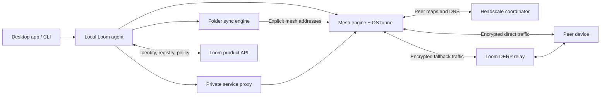

# Loom: private mesh, services, and folder sync

Planning baseline: 16 October 2026. Greenfield repository. File/folder sync confirmed by the user; audience, staffing, and platform order below are proposed assumptions.

## 1. Product direction

**Loom makes your devices, private services, and shared folders feel like one workspace, wherever you are.**

Start with developers and homelab users connecting a laptop, desktop, and server. The differentiator is a single understandable experience across networking, services, and files. The first successful session should take under five minutes: connect two devices, open a private service, and sync a folder.

“Zero configuration” means no manual keys, router rules, IP addresses, peer lists, or DNS setup. Users still approve installation/network permissions, device enrollment, and what they share. Managed coordination and relays provide the default experience; self-hosting comes later.

Initial scope: macOS desktop plus Linux headless agent; one owner and one active network per installation. Invite-based team membership and Windows follow after the personal-device workflow is reliable.

## 2. The first experience

1. Install Loom, sign in through a system browser, and approve the network helper.
2. Loom creates a private network and gives the device a friendly name.
3. Install on another device and sign in. Existing-device approval or a recovery credential authorizes its membership.
4. The Devices screen shows both devices and whether each is reachable, sleeping, or offline.
5. Services offers locally detected candidates. Publishing one requires confirmation and an audience choice. Open the published service from the other device.
6. Select a folder and a destination device. Accept on the destination and choose a local path. Loom begins syncing and shows progress.

Proposed CLI:

```text
loom up
loom devices
loom services
loom publish localhost:3000 --name preview
loom sync add ~/Projects/demo --to desktop
loom doctor
```

CLI and GUI use the same local agent API. Commands above are a proposed product interface, not existing commands.

## 3. Architecture decision

**Reuse established networking and sync engines for v1. Build Loom's product layer and integration.**

| Layer | Proposed choice | Reason and boundary |
| --- | --- | --- |
| Mesh transport | Pinned open-source Tailscale daemon build, behind a Loom adapter | WireGuard overlay, NAT traversal, DNS, and relay transport; isolate upstream integration |
| Mesh coordination | Headscale, initially one isolated instance/data store per private network | Avoid implementing a coordination protocol; validate operational limits before scaling |
| Relays | Loom-operated DERP servers | Carry encrypted traffic when direct connections fail; do not depend on public community capacity |
| Folder sync | Bundled Syncthing process, managed through its local API | Reuse conflict handling, resumable transfer, and filesystem behavior |
| Local agent | Go | Supervises engines, service publishing, policy reconciliation, status, CLI API |
| Desktop | React + TypeScript in Tauri, with a narrow Rust bridge | Tray UX, folder pickers, notifications, platform integration; networking lives outside the webview |
| Product backend | Go + PostgreSQL + OIDC authentication | Accounts, device approvals, registry, grants, audit records; no file contents |
| Agent state | SQLite plus protected credential storage | Cached registry/policy, durable reconciliation, crash recovery |

Headscale documents registration, DNS, policy, and embedded DERP capabilities; validate exact supported behavior against pinned releases. Its stated focus is self-hosted projects and labs, so shared SaaS tenancy must not be assumed. [Headscale features](https://headscale.net/stable/about/features/)

Syncthing exposes a process-control REST API. Treat it as a versioned integration dependency with compatibility checks. [Syncthing REST API](https://docs.syncthing.net/dev/rest.html)

Tailscale's source has a BSD-3-Clause license and Syncthing uses MPL-2.0. Inventory licenses, distribution obligations, third-party components, branding, and platform packaging in the initial spike; this is not permission to redistribute proprietary vendor applications. [Tailscale license](https://github.com/tailscale/tailscale/blob/main/LICENSE), [Syncthing license](https://github.com/syncthing/syncthing/blob/main/LICENSE)

Alternative: Iroh provides authenticated QUIC connections with direct/relay paths and data protocols. It is attractive if Loom becomes an application-level connectivity SDK. For the stated full private-network goal, adding IP tunneling and OS integration around it expands v1 scope. Keep it as an evaluated alternative, not a second transport running alongside WireGuard. [Iroh introduction](https://docs.iroh.computer/)



### Connectivity and process boundaries

- The overlay provides stable private addresses and device DNS. Use names under a domain we control; define collision handling and avoid `.local`.
- Establish relay connectivity while attempting a direct path; upgrade to direct when available and fall back on path failure. Let the mesh engine own path selection. Tailscale documents these transport behaviors and encrypted relay forwarding. [Connection types](https://tailscale.com/docs/reference/connection-types)
- Use the mesh as the only wide-area transport for sync. Configure explicit peer mesh addresses and disable Syncthing public discovery, its separate relays, and independent NAT mapping. Restrict its sync listener to the overlay and its management API to protected loopback access. [Syncthing configuration](https://docs.syncthing.net/users/config.html)
- Separate the privileged network helper from the user-session agent and sync process. Folder reads/writes run as the user. Authenticate local IPC and expose only narrow privileged operations.
- Existing Tailscale/VPN installations, tunnel ownership, DNS conflicts, sleep/wake, and uninstall cleanup are first-milestone acceptance gates.
- Cache network state for control-plane outages. Specify and test what continues after engine restart. New enrollment and grants require coordination; existing access is bounded by cached authorization expiry.

## 4. Service discovery and access

Discovery has two jobs: find devices and find applications on those devices. Device presence alone is insufficient.

- Each agent advertises only approved services: stable ID, publisher device, display name, protocol, endpoint, health, audience, version, and lease expiry.
- The backend filters registry reads by authorization. Agents receive a snapshot followed by revisioned changes; expired or disconnected records become unavailable.
- Start with explicit CLI/UI publishing. Add optional local listener and Docker inspection to suggest candidates; avoid scanning arbitrary LAN devices.
- A service bound to `localhost` needs an agent proxy to be remotely reachable. Only proxy a user-approved target, authenticate the remote device, and enforce grants on every connection.
- Enforce policy in the data path, not just by hiding service cards. Default-deny mesh policy permits required agent/sync channels and explicitly granted service ports.
- Open HTTP services with browser-compatible URLs. Provide copyable host/port or local forwarding for SSH, databases, and other TCP services. Arbitrary UDP publishing is later.
- For browser services, define TLS certificate issuance, Host/Origin handling, WebSocket support, and development-server compatibility. Publishing intentionally changes who can access a loopback-only app.
- Keep service history separate from live availability. A remembered service can show “Device asleep” without pretending it is reachable.

Do not promise transparent multicast forwarding, every Bonjour application, public internet sharing, or automatic publication of every listening port in v1.

## 5. Folder sync behavior

The first version supports explicit two-way folders between approved devices. Both devices must overlap online, or an authorized always-on device must hold a replica. **A network relay forwards packets; it does not retain files for later delivery.** Cloud storage and encrypted store-and-forward are separate future features.

- Destination approval and path selection precede any transfer. Warn about nonempty destinations and show an initial merge preview.
- Use the sync engine's existing block transfer and conflict semantics. Interrupted transfers resume and completed data is verified before final replacement.
- Preserve divergent edits as conflict copies. Show both versions and let users choose; do not silently discard one through a Loom-specific “latest timestamp wins” rule.
- Enable remote-change version retention with a documented default, such as 30 days, and a visible disk budget. Surface exhausted storage instead of silently dropping history.
- Describe version history accurately: Syncthing versioning archives remote replacements/deletions, not every local edit. Sync is not a complete backup. [Versioning](https://docs.syncthing.net/users/versioning.html)
- Define rename, delete-vs-edit, case collision, Unicode, symlink, permission, and locked-file behavior using the engine's supported semantics. Case clashes require a visible resolution flow. [Synchronization behavior](https://docs.syncthing.net/users/syncing?version=v2.1.5)
- Start with regular files/directories. Reject escaping symlinks and unsafe roots; exclude live databases, VM disks, and OS/package metadata from the supported workload until tested.
- Provide an ignore preview, pause/resume, per-folder bandwidth limits, missing-root protection, low-space handling, and an easy conflict-resolution entry point.
- Distinguish “Up to date with desktop” from “Waiting for desktop.” Offline peers cannot confirm receipt of the newest changes.
- Revoking a device prevents future authorized transfers after policy propagation; it cannot retract files already copied to that device.

## 6. Identity, authorization, and privacy

- Generate mesh and sync private keys on-device. Bind both public identities to the same approved Loom device record. Protect credentials through OS facilities and restrictive file permissions.
- Browser login proves account access; device approval authorizes membership. Recovery must have an explicit flow and audit trail rather than quietly bypassing device approval.
- Model Account, Network, Device, Service, Grant, FolderShare, FolderReplica, and AuditEvent. File manifests remain in endpoint sync databases, not the product backend.
- Grants specify subject device/member, resource, allowed action, and optional expiry. Version every policy change, reconcile idempotently, and acknowledge endpoint application.
- Default deny unsolicited peer traffic. Same-owner network membership does not automatically publish every port or folder.
- Revoke at coordination, mesh policy, service proxy, and sync-peer configuration layers. Terminate active sessions where supported. Surface stale/offline policy status.
- Define cached-policy expiry before alpha. Online revocation has a propagation target; an isolated device cannot learn an immediate revocation. Prefer denying new access after a bounded stale-policy window, with the availability tradeoff visible.
- Relays must not receive plaintext payloads, but operators can observe addresses, timings, and traffic volume. The product backend sees account/device and approved registry metadata. Minimize logs and document retention.
- The initial model trusts Loom's coordination service to distribute membership and keys. Protection against a malicious coordinator requires additional device-signed membership/key-distribution design; do not claim that property in v1. [Tailscale's explanation of this trust boundary](https://tailscale.com/docs/features/tailnet-lock)
- Sign installers and updates, pin engine compatibility, support rollback, and redact diagnostics by default.

## 7. UX specification

Four primary destinations:

| Screen | Main question | Primary actions |
| --- | --- | --- |
| Overview | Is my workspace working? | Connect, add device, resolve actionable issue |
| Devices | Which devices can I reach? | Inspect, rename, approve, revoke |
| Services | What can I open? | Search, open, publish, change access |
| Folders | Where are my files and are they current? | Add, pause, inspect progress, resolve conflict |

Tray/menu-bar access provides a connection toggle, recent services, transfer summary, and one-click diagnostics. Use an accessible list-first interface; put a network graph in optional diagnostics if needed.

Model connectivity, sync, and authorization separately. A device may be connected through a relay while a folder is waiting for disk space. State labels should say what happened and offer a relevant action. “Relay connected” is a working connection, not an error.

Support keyboard navigation, screen readers, contrast, reduced motion, and notifications only for actionable changes. Avoid fixed completion percentages when scanning has not established the total work.

## 8. Delivery plan and release gates

Planning estimate: **16–20 weeks for a private alpha with three experienced engineers**, plus design and security-review help. This is a capacity assumption, not a committed schedule. Re-estimate after the integration spike. A solo build should target a much narrower prototype first.

| Phase | Indicative window | Deliverable | Exit gate |
| --- | --- | --- | --- |
| 0. Integration spike | Weeks 1–2 | Two devices, mesh engine adapter, isolated coordinator, relay, sync engine, macOS packaging experiment | Real file transfer and service access on separate networks; UDP-blocked relay fallback; accept or revise engine/packaging strategy |
| 1. Vertical slice | Weeks 3–5 | Install, login, approve device, connect, publish one service, share one folder | Fresh installs complete the end-to-end workflow without manual engine configuration |
| 2. Product workflows | Weeks 6–9 | Registry, proxy, enforced grants, four screens, CLI, sync conflicts/history | Service access and folder scope match permissions; offline/reconnect behavior is understandable |
| 3. Reliability and security | Weeks 10–13 | Policy reconciliation, revoke, outage handling, diagnostics, signed updates | Network/filesystem failure suite passes; no cross-network access; security review findings addressed |
| 4. Private alpha | Weeks 14–16 | Small external cohort, measured onboarding, support tooling | Pilot metrics and reliability goals below met on the declared support matrix |
| Contingency | Weeks 17–20 | Packaging, DNS/VPN coexistence, engine compatibility, filesystem issues | Release only after gates pass |

Defer Windows/mobile, team administration, exit nodes, subnet routing, public tunnels, encrypted cloud replicas, live document collaboration, enterprise SSO features, and large-network HA orchestration. Support one active network per installation initially.

## 9. Verification and proposed success criteria

These are acceptance targets to validate in the spike, not claims about current performance.

- Median two-device setup under five minutes; at least 90% of pilot users finish without assistance.
- All supported network-matrix scenarios either connect directly or use a working relay: LAN, separate home NATs, CGNAT, IPv6, and blocked outbound UDP with permitted relay HTTPS connectivity.
- Reconnect target: p95 under 15 seconds after a stable usable network returns; measure sleep/wake separately.
- A 1 MiB changed file appears on a reachable peer within 10 seconds at p95 under defined test conditions. Large-file throughput is benchmarked relative to the raw mesh path.
- Every committed file matches its source hash. Test interruption, process crash, low disk space, deleted root, and simultaneous edits; require recoverable results without silent overwrite of divergent versions.
- Online device revocation blocks new access within 30 seconds at p95; separately test active-session teardown and cached-policy expiry during partitions.
- Unauthorized devices cannot enumerate private services, open granted-only ports, join folder shares, or cross private-network boundaries.
- Test against a versioned OS/filesystem matrix and exercise engine upgrades, downgrade prevention, rollback, DNS restoration, and coexistence with another VPN.

Use network namespaces/VMs and fault injection for reproducible tests, then validate real home/mobile/restricted networks. Track connection outcomes, reconnect latency, relay byte-hours/egress, engine crashes, sync failures, and onboarding completion with privacy-conscious telemetry.

## 10. Operations and cost controls

Start with one control-plane deployment and persistent backups; add a secondary relay location during alpha and validate failover. Explicitly document control-plane downtime behavior. Load-test coordinator-per-network provisioning before expanding beyond a small cohort.

The primary variable cost is relayed file traffic. Model monthly cost as control-plane/DB baseline + relay compute + provider-billed relay egress + logs/backups. Measure actual bytes and direct-connection rates before setting pricing; do not promise unlimited relay bandwidth. Add fair-use limits, per-account metering, and bounded diagnostic retention.

Relay admission/authentication, abuse controls, and bandwidth attribution are spike decisions: verify supported mechanisms rather than deploying an unrestricted public relay. Rate limiting must not corrupt transfers; show a clear paused/throttled state.

## 11. First implementation backlog

1. Record ADRs for engine reuse, process privileges, tenancy isolation, coordinator trust, and sync-over-mesh.
2. Prototype a private coordinator, authenticated relay approach, and two mesh clients on Linux plus macOS.
3. Prove packaged startup, browser enrollment, tunnel permission flow, DNS cleanup, and existing-VPN behavior on macOS.
4. Run Syncthing exclusively over explicit mesh endpoints; bind its device identity to the approved Loom record.
5. Publish one approved localhost HTTP service through an authenticated peer proxy with an enforced grant.
6. Build one thin UI flow: add device → publish service → sync folder, including offline and conflict states.
7. Automate the first end-to-end failure scenario: interrupt a relayed transfer, restart an agent, reconnect, and verify exact file contents.

Suggested repository layout after the spike: `apps/desktop`, `cmd/loom`, `cmd/loom-agent`, `cmd/loom-api`, `internal/{mesh,sync,services,identity,policy}`, `api`, `deploy`, `tests/e2e`, and `docs/adr`. Keep product code separate from vendored engines and pinned packaging manifests.

The first demo is complete when two fresh installations on separate networks can privately open a localhost service and sync a folder, survive a disconnection, and explain their current state through one Loom interface.
